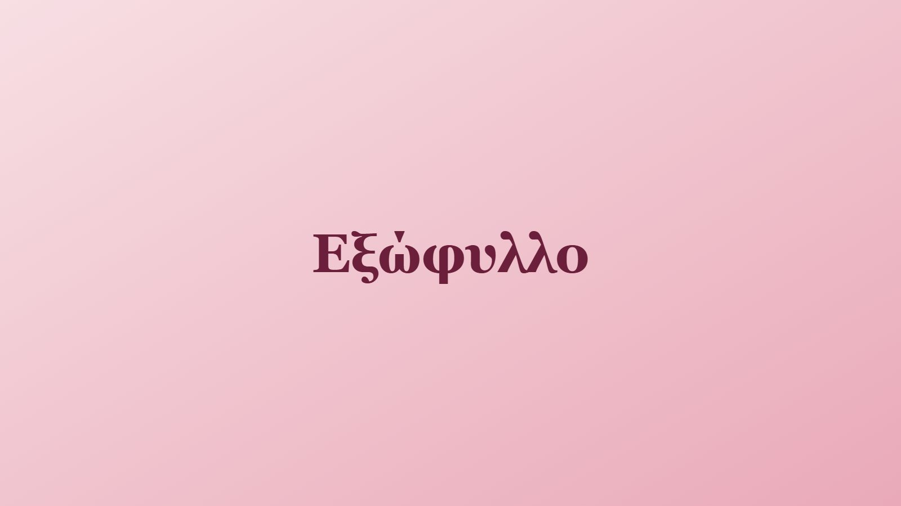

Όταν κάποιος ξεκινά coaching, συχνά περιμένει από τον coach να του δώσει έτοιμες λύσεις. Στην πραγματικότητα, αυτό που αναζητά υποσυνείδητα είναι μια ανακούφιση: να μεταφέρει την ευθύνη των αποφάσεων σε κάποιον άλλον.

Όμως ο ρόλος του coach δεν είναι αυτός. Το coaching δεν αφορά απλώς την επίτευξη στόχων, αλλά τον τρόπο που επιλέγεις να ζεις.

## Τι σημαίνει τελικά «αναλαμβάνω την ευθύνη»;

Ανάληψη ευθύνης δεν σημαίνει «πρέπει να τα κάνω όλα τέλεια». Σημαίνει:

•	Να αποφασίσεις πώς θέλεις να υπάρχεις μέσα στην καθημερινότητά σου.

•	Να σχεδιάσεις πώς ονειρεύεσαι το μέλλον σου.

•	Να αποκτήσεις ξεκάθαρη εικόνα για τους στόχους σου.

Η ζωή σου πρέπει να είναι ευθυγραμμισμένη με τις δικές σου αξίες, τα δυνατά σου σημεία, τις ανάγκες και τις επιθυμίες σου. Το τι θα κάνεις με τη ζωή σου από εδώ και πέρα, δεν μπορεί να το αποφασίσει κανείς άλλος. **Μόνο εσύ.**

**Το coaching είναι μία μέθοδος που σε βοηθάει να:** 

1.	Καθορίσεις προτεραιότητες στη ζωή σου

2.	Αποκτήσεις ισορροπία στην προσωπική και στην επαγγελματική σου ζωή

3.	Κατανοήσεις τις δυνατότητες και τις αδυναμίες σου

4.	Εντοπίσεις και να επιλύσεις τα προβλήματα στη ζωή σου

5.	Βρεις υγιής τρόπους για να επιτύχεις τους στόχους σου

6.	Καθορίσεις και να ισχυροποιήσεις τις αξίες σου για τη ζωή

7.	Σχεδιάσεις και να εφαρμόσεις ένα πλάνο ενεργειών όπου θα σε οδηγήσει στο στοχευμένο αποτέλεσμα

8.	Παραμείνεις σταθερός στις αποφάσεις σου

9.	Αναγνωρίσεις τις επιτυχίες σου

10.	Λειτουργείς με καθαρή σκέψη

### Μια μικρότερη υποενότητα

* Πρώτο σημείο
* Δεύτερο σημείο
